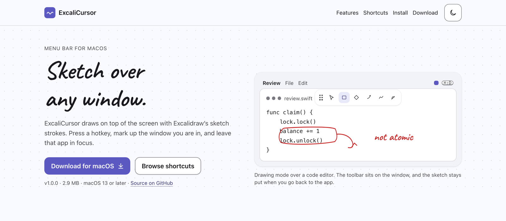

<p align="center">
  <a href="https://sai21112000.github.io/excalicursor/">
    
  </a>
</p>

<h1 align="center">ExcaliCursor</h1>

<h3 align="center">Sketch Excalidraw-style notes over any Mac app, so developers, teachers, and presenters can explain things on screen without leaving the window they're in.</h3>

<p align="center">
  <a href="https://github.com/Sai21112000/excalicursor/releases/latest"></a>
  <a href="https://github.com/Sai21112000/excalicursor/releases"></a>
  
  <a href="LICENSE"></a>
  <a href="https://github.com/Sai21112000/excalicursor/stargazers"></a>
</p>

<p align="center">
  <a href="https://github.com/Sai21112000/excalicursor/releases/latest/download/ExcaliCursor.dmg"><strong>⬇️ Download for macOS</strong></a>
  &nbsp;·&nbsp;
  <a href="https://sai21112000.github.io/excalicursor/"><strong>🌐 Visit the Website</strong></a>
  &nbsp;·&nbsp;
  <a href="#-quick-start"><strong>⚡ Quick Start</strong></a>
</p>

---

## ✨ See It In Action

<p align="center">
  <a href="https://sai21112000.github.io/excalicursor/">
    
  </a>
</p>

<p align="center"><em>Press <kbd>⌘</kbd> <kbd>⇧</kbd> <kbd>D</kbd>, circle the bug, keep typing. Your editor never loses focus.</em></p>

## 🚀 Core Capabilities

- ⌨️ **Instant on, instant off:** One hotkey (<kbd>⌘</kbd> <kbd>⇧</kbd> <kbd>D</kbd>, <kbd>⌘</kbd> <kbd>D</kbd>, <kbd>⌥</kbd> <kbd>D</kbd>, or a double-tap of <kbd>⌥</kbd>) brings up the canvas. It stays invisible until you need it.
- 🖱️ **Never steals your clicks:** When drawing mode is off, every click, scroll, and keystroke goes straight to the app underneath, and your notes stay on screen.
- ✏️ **The Excalidraw look you love:** Rough.js strokes in three sloppiness levels (Architect, Artist, Cartoon), three widths, any color, and hachure fills.
- 🔴 **Presenter-grade laser pointer:** A glowing, fading crimson trail that makes screen shares, code walkthroughs, and live demos easy to follow.
- 🔷 **Messy sketch to clean shape:** Draw freehand, press <kbd>⇧</kbd> <kbd>X</kbd>, and it snaps into a rectangle, diamond, ellipse, or line.
- 🧲 **A toolbar that docks where you want it:** Drag it to any screen edge and it reshapes into a vertical or horizontal dock. Double-click the grip to snap it back.
- 📋 **Share in one keystroke:** <kbd>⌘</kbd> <kbd>C</kbd> copies a transparent PNG of your annotations, ready to paste into Slack, docs, or tickets.
- 🪶 **Native and lightweight:** Pure AppKit with a ~3 MB download. It lives in the menu bar and can start at login.

### ⌨️ Shortcuts at a glance

| Tool | Key | Tool | Key |
| :--- | :---: | :--- | :---: |
| Selection | <kbd>V</kbd> / <kbd>1</kbd> | Text | <kbd>T</kbd> / <kbd>8</kbd> |
| Rectangle | <kbd>R</kbd> / <kbd>2</kbd> | Eraser | <kbd>E</kbd> / <kbd>0</kbd> |
| Diamond | <kbd>D</kbd> / <kbd>3</kbd> | Laser pointer | <kbd>K</kbd> |
| Ellipse | <kbd>O</kbd> / <kbd>4</kbd> | Draw to shape | <kbd>⇧</kbd> <kbd>X</kbd> |
| Arrow | <kbd>A</kbd> / <kbd>5</kbd> | Bucket fill | <kbd>B</kbd> |
| Line | <kbd>L</kbd> / <kbd>6</kbd> | Hand (pan) | <kbd>H</kbd> |
| Freehand pen | <kbd>P</kbd> / <kbd>7</kbd> | Lock tool | <kbd>Q</kbd> |
| Undo / Redo | <kbd>⌘</kbd> <kbd>Z</kbd> / <kbd>⌘</kbd> <kbd>⇧</kbd> <kbd>Z</kbd> | Clear canvas | <kbd>C</kbd> |
| Copy PNG | <kbd>⌘</kbd> <kbd>C</kbd> | Exit drawing | <kbd>Esc</kbd> |

## ⚡ Quick Start

Download and open the installer (macOS 13 Ventura or later):

```bash
curl -L -o ExcaliCursor.dmg https://github.com/Sai21112000/excalicursor/releases/latest/download/ExcaliCursor.dmg && open ExcaliCursor.dmg
```

Drag **ExcaliCursor** into **Applications**. The app is not notarized yet, so on first launch right-click it and choose **Open**. Then say hello:

```text
1. Look for the sketch icon in the menu bar.
2. Press ⌘ ⇧ D to enter drawing mode.
3. Press R and drag to draw your first rectangle.
4. Press Esc. Your sketch stays, and your clicks go back to the app underneath.
```

> [!TIP]
> Double-tap <kbd>⌥</kbd> needs ExcaliCursor allowed in **System Settings → Privacy & Security → Accessibility**. The keyboard shortcut works without any permission.

<details>
<summary><strong>Build from source</strong> (Swift 5.9+ or Xcode Command Line Tools)</summary>

```bash
make app && make run   # build ExcaliCursor.app and launch it
make dmg               # write build/ExcaliCursor.dmg with an /Applications shortcut
```

</details>

## ❤️ Support the Project

| 🌱 Community | ⭐ Sponsor | 🏢 Custom |
| :--- | :--- | :--- |
| Free forever under the MIT license | Help keep ExcaliCursor maintained | Tailored builds for your team |
| Every drawing tool, the laser pointer, and PNG export | Your name in the release notes | Custom branding, default hotkeys, and presets |
| Community help through GitHub Issues | Early input on the roadmap | Help with deployment and priority fixes |
| **[Download Free →](https://github.com/Sai21112000/excalicursor/releases/latest/download/ExcaliCursor.dmg)** | **[Star & Sponsor →](https://github.com/Sai21112000/excalicursor/stargazers)** | **[Get in Touch →](https://github.com/Sai21112000/excalicursor/issues/new?title=Custom%20build%20inquiry)** |

## 🤝 Trusted By & Community

<p align="center">
  <a href="https://github.com/Sai21112000/excalicursor/graphs/contributors">
    
  </a>
</p>

<p align="center">
  Found a bug or have an idea? <a href="https://github.com/Sai21112000/excalicursor/issues"><strong>Open an issue</strong></a>
  &nbsp;·&nbsp;
  Want to dig into the internals? <a href="docs/index.md"><strong>Read the docs</strong></a>
</p>

---

<p align="center">
  <a href="https://sai21112000.github.io/excalicursor/">Website</a>
  &nbsp;·&nbsp;
  <a href="https://github.com/Sai21112000/excalicursor/releases">Releases</a>
  &nbsp;·&nbsp;
  <a href="docs/index.md">Documentation</a>
  &nbsp;·&nbsp;
  <a href="LICENSE">License</a>
</p>

<p align="center"><sub>© 2026 ExcaliCursor. Released under the MIT License. Excalidraw is a trademark of its respective owners; this project is not affiliated with it.</sub></p>
