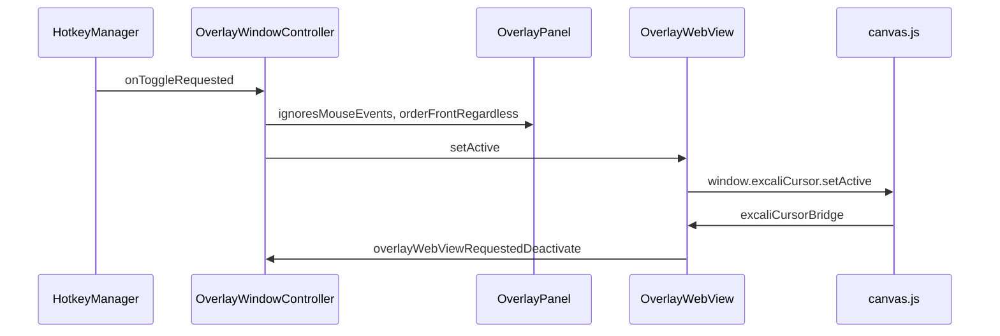

After reading this page you can follow a hotkey from Carbon into a `WKWebView`, and you can see which module is allowed to touch preferences, panels, and strokes.

One process runs. `main.swift` creates the shared `NSApplication`, assigns `AppDelegate`, sets `.accessory`, and calls `app.run()`. There is no worker, cron, or second executable in `Package.swift`.

## Runtime shape

`AppDelegate.applicationDidFinishLaunching` builds the status item, one `OverlayWindowController`, and a transient settings popover. `OverlayWindowController` creates one `OverlayPanel` and one `OverlayWebView` for each `NSScreen`. The panel frame is `screen.frame`. Its window level is `CGWindowLevelForKey(.dockWindow) - 1` (`OverlayPanel.swift`).

While drawing mode is off, `ignoresMouseEvents` is true and the page has class `inactive`, so the dock is not hit-testable. Turning drawing on orders every panel front, makes the panel under the pointer key, and calls `window.excaliCursor.setActive` in that page.

A screen-parameter notification closes panels whose display id disappeared, resizes panels that remain, and creates panels for new screens (`OverlayWindowController.handleScreenParametersChanged`). Display id is `NSScreen.deviceDescription["NSScreenNumber"]`.

Menu actions in `AppDelegate` call the same controller methods. `selectTool`, `undo`, `redo`, and `clearAllCanvases` run on every web view. `copyActiveCanvasToClipboard` uses the panel whose frame contains `NSEvent.mouseLocation`, or the first overlay if none contains it.

## Module boundaries

| Module | May call | Does not call |
| --- | --- | --- |
| `main.swift` | `NSApplication`, `AppDelegate` | Canvas, hotkeys |
| `AppDelegate` | `HotkeyManager.shared`, `OverlayWindowController`, `SettingsPopoverViewController` | `canvas.js` directly |
| `SettingsPopoverView` | `HotkeyManager` fields, `SMAppService.mainApp`, closures from `AppDelegate` | Web views |
| `HotkeyManager` | `UserDefaults`, Carbon `RegisterEventHotKey`, `NSEvent` monitors, three callbacks | Panels, JavaScript |
| `OverlayWindowController` | `OverlayPanel`, `OverlayWebView`, reads `HotkeyManager` flags | `UserDefaults` |
| `OverlayWebView` | `window.excaliCursor.*`, `NSPasteboard` on `copyImage` | `HotkeyManager` |
| `canvas.js` | `webkit.messageHandlers.excaliCursorBridge` | Swift types |

`canvas.html` loads `rough.min.js` then `canvas.js`. The file header in `rough.min.js` calls that script a Rough.js v4.6-compatible canvas engine bundled for this app.

`OverlayWebView.loadCanvasHTML` resolves `canvas.html` in this order: `Bundle.module`, then `Bundle.main`, then `Sources/ExcaliCursor/Resources/` under the current directory. `Makefile` `app` copies `ExcaliCursor_ExcaliCursor.bundle` into the app’s `Contents/Resources` when that bundle exists, and also copies `Sources/ExcaliCursor/Resources/*` there. The first URL that exists is the one loaded.

## State and consistency

| State | Where | Consistency |
| --- | --- | --- |
| Trigger, hotkey, double-tap interval, clear-on-deactivate, hide-when-inactive | `UserDefaults` via `HotkeyManager` | Written in each property’s `didSet` before hotkeys are reconfigured. A rejected hotkey is replaced with `lastGoodCombo` and those two keys are written again. |
| Login item | `SMAppService.mainApp.status` | Settings sets the toggle from `.enabled` after `register()` or `unregister()`. |
| Strokes, pan, tool, selection, redo stack, laser trails | `state` in each `canvas.js` | One array per web view. Screens do not copy `state.elements` to each other. |
| Dock position, orientation, dark toolbar | `localStorage` key `ExcaliCursor.dockPrefs.v1` | Written by `saveDockPrefs` in the page that moved the dock. |
| Clipboard PNG | `NSPasteboard.general` | One write from the web view that received `copyCanvasToClipboard`. |

`WKWebViewConfiguration` in `OverlayWebView` does not set a custom `WKWebsiteDataStore`. Whether two displays share the default store’s `localStorage` is not set in that file.

Undo is one element at a time (`canvas.js` `undo` / `redo`). `pushElement` clears `redoStack`. Erase, Delete, and Clear push removed elements onto `redoStack` without grouping them. Stroke color, width, roughness, and bucket fill mutate the element in place and do not push a new undo entry.

Laser points stay in `state.laserTrails` and fade with `LASER_DECAY_MS` of 820. They are not elements.

> **Boundary:** The overlay level stays under the Dock window level, so the menu bar and Dock remain clickable (`OverlayPanel.swift`).
